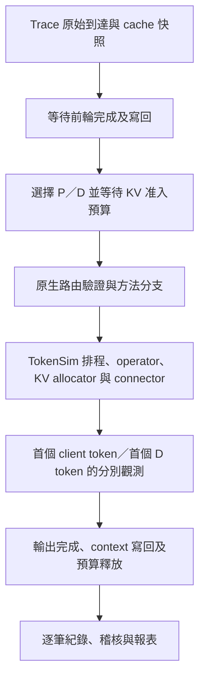

# TokenSim 客製化實驗規格

本文件說明目前 Mooncake 通訊頻寬與 TP 實驗使用的客製化方式，讓結果可以依設定、程式與逐筆紀錄核對。模擬以 TokenSim 的 operator 計時、paged-attention 排程、KV 配置與 connector 為基礎，另加入多輪相依、方法分支、准入預算、TP 群組交接及統計流程。

結果表示「這些硬體與系統政策假設下的模擬表現」。公開程式與設定提供可重現性；實體 GPU 上的延遲準確度仍須另外量測驗證。

## 1. 實驗範圍與設定檔

本文件涵蓋 `five-stage-llama7b-h100-tp{1,2,4,8}-s0-01` 的 Mooncake 正式實驗，以及相同設定的 TP1 重跑。較早 ServeGen 200／8,000 requests 的 50／100／200 GB/s 實驗有各自的設定，不套用本文件的所有參數。

| 項目 | 本次規格 |
|---|---|
| 模型 | `llama-7b`，FP16 權重與 FP16 KV |
| GPU | H100 SXM；catalog 記憶體容量為 80 GiB／GPU |
| 部署 | 4 個 P 模型群組＋4 個 D 模型群組，PP＝1 |
| TP | 分別為 1、2、4、8；每群組使用 TP 張 GPU |
| 方法 | Serial、adapted PPD、MigrationTax |
| Trace | 完整 Mooncake shifted v1，seed 0 |
| 輸入筆數 | 12,031 requests，其中 3,959 筆 returning turns |
| 輸出量 | 4,122,048 tokens |
| 正式條件數 | 每個 TP：1 組 Serial inf reference＋3 條有限頻寬 × 3 種方法＝10 組 |
| 階段對應 | 階段 1：inf Serial＋nvl4 三方法；階段 3：pcie6 三方法；階段 4：ib400 三方法 |

原始 TP8 五階段設計還包含 sanity 與 ServeGen；上表只計算 Mooncake 正式條件。TP1／2／4 的這批比較採相同 10 組，不包含 ServeGen 或 sanity。

設定與紀錄皆相對於本專案根目錄：

| TP／用途 | 設定資料夾 | Run 資料夾名稱，位於 `native_research/runs/` |
|---|---|---|
| TP1 | [config/five-stage-llama7b-h100-sxm80gb-tp1-s0/](config/five-stage-llama7b-h100-sxm80gb-tp1-s0/) | `five-stage-llama7b-h100-tp1-s0-01` |
| TP2 | [config/five-stage-llama7b-h100-sxm80gb-tp2-s0/](config/five-stage-llama7b-h100-sxm80gb-tp2-s0/) | `five-stage-llama7b-h100-tp2-s0-01` |
| TP4 | [config/five-stage-llama7b-h100-sxm80gb-tp4-s0/](config/five-stage-llama7b-h100-sxm80gb-tp4-s0/) | `five-stage-llama7b-h100-tp4-s0-01` |
| TP8 | [config/five-stage-llama7b-h100-sxm80gb-tp8-s0/](config/five-stage-llama7b-h100-sxm80gb-tp8-s0/) | `five-stage-llama7b-h100-tp8-s0-01` |
| TP1 同設定重跑 | [config/five-stage-llama7b-h100-sxm80gb-tp1-s0-rerun02/](config/five-stage-llama7b-h100-sxm80gb-tp1-s0-rerun02/) | `five-stage-llama7b-h100-tp1-s0-02` |

各資料夾的 `hardware.json`、`cluster.json`、`links.json`、`study_*.json`、`transfer_*.json`、`metrics.json` 與 `input-manifest.json` 分別保存硬體、群組、連線、傳輸、統計及輸入規格。

## 2. 原生機制與客製化內容

| 部分 | 使用方式 |
|---|---|
| 計算延遲 | 使用 TokenSim operator backend 與 analytical fallback；方法計畫不自行指定運算秒數 |
| GPU KV 管理 | 使用原生 block allocator、prefix cache、共享、eviction 與 copy-on-write（COW） |
| 基本排程與傳輸 | 沿用原生 paged-attention 排程及 connector，加入下列方法與交接流程 |
| Trace 轉換與身分 | 客製化保留原始到達、對話、輪次、前輪相依及 prefix block 身分 |
| 方法分支 | 客製化 Serial、adapted PPD、MigrationTax 的 cache 狀態分支與原生事件銜接 |
| 准入與路由 | 客製化完整生命週期 KV 預算、P／D 選擇及對話 D affinity |
| MigrationTax | 客製化 HF 的 P 端先輸出與交接、FF 的逐層計算／傳輸及 ownership barrier |
| TP 群組 | 客製化以群組 leader 統一交接、共享對稱頁面帳本與完整群組 KV 傳輸 |
| 完成與統計 | 擴充完整 context 寫回、完成通知、到達時 cache 快照、D-first 觀測及報表 |



方法計畫位於 [algorithm/native.py](algorithm/native.py)；原生引擎接入位於 [native_runtime.py](TokenSim/TokenSim/research/native_runtime.py)。這個版本包含 TokenSim 內部擴充，客製化範圍涵蓋外部 wrapper 與引擎內的排程、交接流程。

## 3. 模型、GPU 與 KV 容量公式

| 項目 | 設定 |
|---|---:|
| 模型參數量 | 6,738,149,376 |
| 層數／hidden size | 32／4,096 |
| Attention heads／KV heads／head dimension | 32／32／128 |
| 權重與 KV 每個元素 | 2 bytes，FP16 |
| GPU 記憶體 | 85,899,345,920 bytes＝80 GiB／GPU |
| 執行環境預留 | 4,169,138,176 bytes／GPU |
| HBM bandwidth | 3,352,000,000,000 bytes/s／GPU，所有連線條件固定 |
| FP16 peak compute | 989.4 × 10¹² FLOP/s／GPU |
| KV block | 64 tokens |
| 排程上限 | `max_num_seqs=64`、`max_num_batched_tokens=8192`／模型群組 |
| 記憶體使用參數 | `gpu_memory_utilization=1.0`；另扣除模型權重及上述預留量 |

80 GiB 是本機 catalog 的實際容量假設；文件中的產品名稱 H100 80GB 與這個二進位容量值應分別辨識。GB/s 使用十進位，1 GB/s＝10⁹ bytes/s；GiB 使用二進位，1 GiB＝2³⁰ bytes。

令 `T` 為 TP、`M` 為單卡容量、`R` 為單卡預留、`b=64` 為每 block tokens：

```text
完整權重 W = 6,738,149,376 × 2 = 13,476,298,752 bytes
完整模型每 token KV K = 2(K/V) × 32層 × 32 KV heads × 128 × 2
                     = 524,288 bytes/token

每 rank 權重       = W / T
每 rank 每 token KV = K / T
每 rank blocks N   = floor((M − R − W/T) / (b × K/T))
群組 token 容量    = N × b
群組 KV 容量       = N × b × K
模擬 GPU 總數      = (4P + 4D) × T
```

| TP | GPU 總數 | 權重 GiB／rank | KV bytes／block／rank | Blocks／rank | Tokens／模型群組 | KV GiB／模型群組 |
|---:|---:|---:|---:|---:|---:|---:|
| 1 | 8 | 12.55078125 | 33,554,432 | 2,034 | 130,176 | 63.56250 |
| 2 | 16 | 6.275390625 | 16,777,216 | 4,469 | 286,016 | 139.65625 |
| 4 | 32 | 3.1376953125 | 8,388,608 | 9,341 | 597,824 | 291.90625 |
| 8 | 64 | 1.56884765625 | 4,194,304 | 19,084 | 1,221,376 | 596.37500 |

TP ranks 保存同一模型的不同分片，因此群組 token 容量不能再乘以 TP。TP 增加時，總 GPU 數、權重分攤及 KV 可用容量也一起改變；本實驗比較的是這些部署設定，並非固定總 GPU 數的純 TP 加速比。

容量計算依據：[native_methods/hardware_profile.py](native_methods/hardware_profile.py)。

## 4. 輸入、多輪與 cache 狀態

各 TP 使用相同 Mooncake 輸入，SHA-256 為：

```text
dec3adb6a385c640c27346a4e34598f9aedb2f1c6b366f73f0202cc044b258b1
```

本批沒有依 TP 篩除請求、截短 tokens 或重縮到達時間。最長請求的 `context + output − 1` 為 126,526 tokens；含兩頁准入餘裕仍可單獨放入 TP1。部分長度超出模型 catalog 的訓練 context 範圍，本實驗保留長度進行計時外推，沒有驗證這些長度的實際生成品質或部署可行性。

輸入使用 `source_id`、對話、原始 `source_turn` 與 `previous_source_id`。Returning turn 必須等待指定前輪完成及寫回，再進入准入。Prefix 依來源與祖先區段建立 block hash，模擬相同前綴的 KV 身分；沒有執行文字生成或保存實際 KV tensor，也沒有自行假設跨對話文字相同。

| Cache 狀態 | P 端 inherited prefix | D 端 inherited prefix |
|---|---|---|
| HH | 完整命中 | 完整命中 |
| HF | 完整命中 | 未完整命中 |
| FH | 未完整命中 | 完整命中 |
| FF | 未完整命中 | 未完整命中 |

第一個字母表示 P，第二個表示 D；部分命中歸為 F。沒有 inherited prefix 的請求走 FF。

**Cache 觀察有兩個時間點。** 方法分支依實際路由時的命中狀態決定；decode miss 指標則在原始到達時先拍攝各裝置快照，再取最終選定 D 的前綴覆蓋量。兩者之間可能經過前輪等待與准入，因此不能混用。頻寬也可能改變後續 cache 演變，不能預設各方法、各連線一定有相同命中比例。

程式依據：[inputs.py](native_methods/inputs.py)、[identities.py](native_methods/identities.py)、[native_study.py](TokenSim/TokenSim/research/native_study.py)。

## 5. 准入預算與路由政策

這部分是我們額外加入的保守政策。它在請求提交原生引擎前，先取得足以完成該請求的 KV 預算，避免排隊中的 prefix reader 提前固定大量頁面。

令 `C` 為完整輸入 context tokens、`O` 為預定輸出 tokens、`b=64`：

```text
P 預算 blocks = ceil(C / b) + 2
D 預算 blocks = ceil((C + O − 1) / b) + 2
可用預算       = 原生 allocator 總 GPU blocks − watermark blocks
```

`C+O−1` 表示最後一個輸出 token 尚未經下一次 forward，因而尚未產生自身 KV。額外兩頁保守涵蓋 COW 尾頁與輸入／輸出邊界頁。

這個預算使用 Trace 已知的輸出長度，等於預先知道最終輸出量的假設。它不折抵 prefix cache 或共享 blocks；實際頁面配置、共享、eviction 與 COW 仍由原生 allocator 處理。因此「預算占滿」不等於實體 KV 頁面已全部用完。

一般先取得 P 預算，再取得 D 預算。Adapted PPD 在 D 完整命中時，可先取得 D、重新確認命中後以零 P 預算提交；若命中已消失，釋放 D 後回到一般路徑。MigrationTax 的 D-local 分支在確認後釋放 P 預算。其餘預算依安全交接或完成事件釋放。單筆超出容量時明確拒絕，沒有靜默截短輸入。

| 路由 | 依序比較的條件 |
|---|---|
| P 選擇 | 較多本地 prefix 命中 tokens → 較少已占預算 blocks → 較少 waiting＋running → 較小 worker ID |
| Returning 的 D | 優先延續該對話之前使用的 D |
| 新對話的 D | 較少已占預算 blocks → 較少 waiting → 較小 worker ID |

選定裝置後，由 `BudgetRouter` 限定候選，再執行原生路由驗證與 cache／lease 處理。這套政策不是全域 JSQ。預算等待採 SimPy Container 排隊，可能產生先到大型需求阻擋後續需求的現象。

當 TP1 的 KV 預算接近多個長請求的同時需求時，准入等待與後續多輪相依等待可能放大。TP 增加也擴大群組 KV 容量，可能跨過這個排隊門檻；不能將整體 TTFT 倍數直接視為 operator 運算加速倍數。提高准入容量或改成共享感知預算，會改變所研究的系統情境。

程式依據：[native_admission.py](TokenSim/TokenSim/research/native_admission.py)。

## 6. 方法分支與交接

| 方法／狀態 | 實際處理 |
|---|---|
| Serial | P 處理新增輸入；P 缺前綴時從 Store 載入。依 D 的既有覆蓋傳送所需 KV，再由 D 輸出及 decode |
| Adapted PPD：HH／FH | 在 D 執行新增輸入的 local prefill，再 decode |
| Adapted PPD：HF／FF | 回到 Serial 路徑 |
| MigrationTax：HH／FH | D-local prefill，再 decode |
| MigrationTax：HF | P 端先輸出 `k=min(2,O)` 個 tokens，將 base KV 傳輸與 P 端後續工作重疊，再同步新增的 `k−1` 個有效 token KV，通過 ownership barrier 後由 D 接續 |
| MigrationTax：FF | 以 32 層事件串接 Store→P、P 計算與 P→D 傳輸，再由 D decode |

MigrationTax FF 的各層使用原生 operator 組合與 TP collective 計時。這裡沒有使用 Splitwise adapter 的「全模型時間除以層數」做法。P 端另將 FF pipeline 與一般請求分成 cohort，以最早到達請求決定服務哪一類；類內維持原生 batch 選擇，D 維持原生 mixed context／decode batching。

HF 的 KV 交接包含來源頁面固定、目的地配置、COW 與完成屏障。實際傳輸使用 block 粒度，不能單用邏輯 token 差值推算最終傳輸 bytes。若 `O≤2`，所有 client 輸出可能已在 P 完成；仍須完成必要交接與寫回，但可能沒有真正的 D 輸出樣本。

完成時擴充寫回已物化的 context；Store 發布的是完整 blocks，最後不足一個 block 的尾端不等於完整發布到 Store。請求完成時間與下一輪相依通知涵蓋所需寫回等待。

程式依據：[native_migration.py](TokenSim/TokenSim/research/native_migration.py)、[native_migration_layers.py](TokenSim/TokenSim/research/native_migration_layers.py)、[native_migration_transport.py](TokenSim/TokenSim/research/native_migration_transport.py)、[handover_writeback.py](TokenSim/TokenSim/llm/handover_writeback.py)。

## 7. TP 群組、通訊與 Store

TP>1 時，一個 leader 負責模型群組的排程與交接，各 GPU rank 保有分片運算幾何與容量，使用對稱的共同頁面帳本。完整 TP 群組的 KV bundle 經單一群組端點傳輸，頻寬不再乘以 rank 數，完成屏障等待整份 bundle。TP1 使用一般 worker 交接，TP>1 啟用 `handover_tp_groups` 擴充。

這個抽象沒有分別模擬每個 rank 的獨立 NIC、異質容量或不同抵達進度。TP 群組內 collective 仍使用原生計時，詳見 [handover_parallel.py](TokenSim/TokenSim/llm/handover_parallel.py)。

| 條件 | KV／host 連線 | 單方向 bandwidth，bytes/s | GB/s | 固定 link latency |
|---|---|---:|---:|---:|
| nvl4 | `nvlink4` | 450,000,000,000 | 450 | 1 μs |
| pcie6 | `pcie6_x16` | 128,000,000,000 | 128 | 3 μs |
| ib400 | `ib_ndr400` | 50,000,000,000 | 50 | 3 μs |
| inf reference | `inf_link` | 1,000,000,000,000,000 | 1,000,000 | 0 μs |

TP 群組內 `scale_up_link` 固定為 `nvlink4`，450 GB/s。每個 data copy 的 `host_link` 與 KV connector bandwidth 隨上表變動，HBM bandwidth 全程固定。`pcie6`、`ib400` 在此表示傳輸模型條件，並非宣稱實際 H100 SXM 已接上這些相同物理拓樸。

```text
本批均勻 P→D 服務時間（秒）
  = 有效固定延遲（μs）/ 10⁶ + 完整 TP KV 傳輸 bytes / 選定 bandwidth
```

Connector 的 cross-node 分支會乘上 1.5 倍固定延遲，config 已補償成上表有效值，例如 nvl4 設定 `2/3 μs`，執行後為 `1 μs`。KV 服務公式不套用 link metadata 的 half-bandwidth ramp 或 collective efficiency；TP collective 使用自己的模型。

MigrationTax 的額外傳輸排程為每一組「來源端點、目的端點」建立一條 FIFO resource；不同端點對可以重疊。它沒有模擬整個 fabric 共用頻寬、雙向耦合與所有交換器壅塞。Store 傳輸另受原生 host／network 路徑限制，不能一律把所有路徑視為單純 bytes／設定頻寬。

| Store 項目 | 設定 |
|---|---|
| Connector | `MultiConnector`：`MooncakeConnector`＋`MooncakeStoreConnector` |
| 角色／協定 | `kv_both`／RDMA |
| 模式 | embedded DRAM Store，`enable_offload=false` |
| 容量參數 | `memory_capacity_blocks=10,000,000` |
| Staging buffer | `local_buffer_size_gb=1`；parser 以 1 GiB／群組端點計算 |
| Replica／policy | 1；always admission、LRU eviction、mooncake save policy |
| 非同步參數 | `load_async=false`、`transfer_overlap=false` |
| 額外 host 上限 | 本批未另設歷史 70B 實驗的 4 TiB host budget |

8 個模型群組對應 8 個端點 buffer，沒有按 64 個 GPU ranks 各配置一份。上述 connector 非同步參數沒有取消 MigrationTax 自己透過事件相依安排的計算／傳輸重疊。

## 8. 計時來源與單位

設定為 `latency_backend_type=operator_table`、`operator_backend=vllm`。`vllm` 是 operator 資料來源的識別欄位；模擬過程沒有實際執行 vLLM 或 CUDA kernels。查不到相符資料時使用原生 analytical fallback；已完成的本批條件，其 compute match 紀錄為 analytical，不能稱為相同 FP16 條件的實測延遲。

原生 roofline helper 的基本形式為：

```text
t_memory = operator bytes / (HBM bandwidth × memory_efficiency)
t_compute = operator FLOPs / (peak compute × compute_efficiency)
t_operator_us = max(t_memory, t_compute) × 10⁶ + launches × kernel_launch_us
```

Catalog 的 `memory_efficiency=0.8`、`kernel_launch_us=3`、`collective_launch_us=10`、`step_overhead_us=0`。不同 operator 使用各自形狀與成本；整體時間還包含 TP collective、排程、傳輸與等待，不能用單一 roofline 項取代完整流程。

Roofline helper 回傳 μs，由呼叫端轉為秒；原生 operator backend 與報表時間以秒記錄，傳輸 fixed latency 的 μs 亦須除以 10⁶。Operation 累計時間可能包含重疊，不等於請求 critical path。實際使用來源以 `operator_match_type_counts`、`parallel_comm_match_type_counts` 核對。

程式依據：[latency/base.py](TokenSim/TokenSim/latency/base.py) 及各條件 `effective-config.json`、`native/result_*.json`。

## 9. 指標定義與統計分母

令 `a` 為原始到達、`p` 為前輪完成含寫回、`e=max(a,p)`（無前輪則為 `a`）、`s` 為准入後提交引擎、`f` 為首個 client token、`d` 為 D 實際首次輸出、`w` 為完成含寫回：

| 指標 | 定義／單位 |
|---|---|
| 等待前輪完成 | `e−a`，秒；包含前輪累積等待及寫回 |
| 等待准入 | `s−e`，秒；對應 `native_budget_wait_s` |
| 准入後至 client 首 token | `f−s`，秒；包含引擎排隊、運算及傳輸 |
| Client TTFT | `f−a = (e−a)+(s−e)+(f−s)`，秒 |
| D-first latency | `d−a`，秒；取 `first_d_output_sampled_at_s` |
| 完整生命週期 | `w−a`，秒；包含寫回 |
| Per-request mean TPOT | `native_decode_time_sum_s / max(1,O−1)`，s/token；沿用原生累計欄位，短輸出以分母 1 處理 |
| Avg TPOT | 先算每筆 TPOT，再對請求等權平均；不是依輸出 tokens 加權 |
| 整批輸出吞吐 | `ΣO / simulated_end_s`，tokens/s；觀察窗為模擬時間 0 至最後完成，包含到達空檔 |
| 整批 request throughput | `完成請求數 / simulated_end_s`，requests/s |

HF 可以先在 P 輸出，所以 client TTFT 與 D-first 是不同終點。`first_d_output_visible_at_s` 還可能記錄 KV ownership 完成時間，亦不能替代真正的 D 輸出樣本。TPOT 使用原生 decode 累計口徑，並非從所有 client token 時間戳重新建構跨 P→D 的完整 ITL 序列。

Avg、P50、P95、Max client TTFT 的分母為全部完成請求，包含初輪與 returning。P50 使用中位數；P95 使用 nearest-rank：排序後第 `ceil(0.95N)` 筆；P99 沿用原生 `prefill_time.p99`，保留原生百分位演算法。這批只有 seed 0，沒有跨 seed 中位數；同 seed 重跑只檢查重現性。

### Affected share 與 decode miss

每個 TP 使用自己的 Serial inf reference。相同請求按 `source_id` 配對，並核對原始輪次、到達、輸入 hash 與輸出長度。

```text
Returning turn：source_turn > 0
Affected：D-first(method, i) > 2 × D-first(Serial inf, i)
Affected share：affected returning turns / 3,959 × 100%
Decode miss share：原始到達時，選定 D 未完整持有前綴的 returning turns / 3,959 × 100%
```

Affected 門檻為嚴格大於，分母包含所有 returning cache cells。HH 也可能受系統排隊影響；沒有強制將 HH 設為零。Decode miss 使用原始到達快照，不能替換成已包含 Store load 的 `d_admit_hit`。

若短 HF 回應全部在 P 完成而沒有 D sample，保留缺值並產生 affected 下／上界；不拿 client TTFT 或 ownership 時間補值。跨 TP 的 reference 也改變，因此 affected 百分比較低不必然代表絕對 TTFT 較低。

統計程式：[report_five_stage_links.py](native_research/report_five_stage_links.py)。

## 10. 原始證據與解讀範圍

每個正式條件的輸出路徑形式為：

```text
native_research/runs/<run>/phase-<1|3|4>/mooncake/<link>/<method>/seed-0/
```

| 檔案／位置 | 核對內容 |
|---|---|
| `effective-config.json`、`condition.json` | 實際設定、輸入與程式來源識別 |
| `requests.jsonl` | 每筆 TTFT、生命週期、預算等待、D-first 與 cache 觀測 |
| `native-route-decisions.jsonl` | 方法分支與裝置選擇 |
| `native-admission-budget.json` | 各裝置預算容量、尖峰與結束占用 |
| `native-end-state.json` | 原生引擎結束狀態 |
| `native-migration-evidence.json`、`native-migration-events.jsonl.gz` | MigrationTax 事件與交接證據，視方法產生 |
| `native/result_*.json` | 原生延遲、KV／connector、operator 與 TP 統計 |
| `source-snapshot/` | 本條件保存的來源快照 |
| 相鄰 `seed-0-job/` 的 `job.json`、`audit.json`、stdout／stderr、telemetry | Process 完成、工作量核對、實際牆鐘時間與主機資源 |
| `native_research/reports/<run>/` | 彙整 Markdown、CSV 與圖表 |

完成稽核用來確認 process 正常結束、請求／輸出數對應及狀態清理；這些檢查本身不代表計時模型已校準到實體 GPU。

本實驗可用來比較指定模型、容量、路由、保守准入與通訊假設下的三種方法。大幅 TP 差異需連同准入及前輪等待分解解讀；整批吞吐則不能直接宣稱為最大可持續服務能力。若要推論真實部署延遲，仍需在相同 workload 與政策下，另以 vLLM 等實際執行環境驗證。
