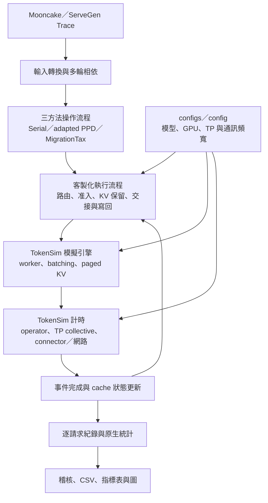

## TokenSim 補充實驗 - 2 - Bandwidth

### 遠端分支與實驗紀錄

- [程式與設定分支](https://github.com/milin-chang/MigrationTax_extend_experiment/tree/tokensim-llama7b-tp8-bandwidth-s0)
- [實驗紀錄與結果 Release](https://github.com/milin-chang/MigrationTax_extend_experiment/releases/tag/tokensim-llama7b-tp8-bandwidth-s0-2026-11-11)
- [收錄範圍與還原方式](PUBLICATION.md)

Release 收錄本文三批實驗的原始 log、逐請求結果、來源快照與報表。ServeGen 200／8,000 筆各完成 10 組；五階段的 Mooncake 12 組全部完成，另保留 ServeGen 1 組完成與 1 組失敗紀錄，完整 22 組尚未全部完成。其他批次的執行紀錄、probes 與已被取代的設定不納入這次發布。

分支也直接保留這三批的 `native_research/reports/<實驗名稱>/`，可在 GitHub 查看指標表、CSV 與目錄內的圖表。原始 `runs/` 與額外的 Mooncake 圖包仍由 Release 提供。


### 一些資料夾的用意
| 資料夾 | 用處 |
| --- | --- | 
|algorithm/  | 演算法邏輯 |
| Trace/ | 下載的 Trace |
| native_research/ | 腳本、結果會在這邊 |
| native_methods/ | 負責載入輸入、啟動單組實驗、套用硬體規格、限制 CPU／記憶體，以及保存來源快照與執行紀錄，配合客製化 TokenSim |
| TokenSim/ | 這邊是客製化的，阿就加了一些模組這樣 |
| configs/  | servegen7b-tp8-bw-s0-200-01、servegen7b-tp8-bw-s0-8000-01的設定 |
| config/ | five-stage-llama7b-h100-tp8-s0-01 的設定 |

> 至於為甚麼有 configs、config，純失誤沒有寫在一起，時間趕就失誤了

---
### 目前實驗種類

1. **servegen7b-tp8-bw-s0-200-01**：200 個 ServeGen 請求，比較 50、100、200 GB/s 的 KV 通訊頻寬與高頻寬 Serial reference。
2. **servegen7b-tp8-bw-s0-8000-01**：8,000 個 ServeGen 請求，比較相同通訊條件；沿用既有容量篩選子集。
3. **five-stage-llama7b-h100-tp8-s0-01**：規劃完整 Mooncake／ServeGen 的五階段實驗；目前以已完成的 Mooncake 結果為主要報告。

以上均固定 GPU HBM 記憶體頻寬，調整的是 KV 通訊頻寬。

第三個比較特別一點，參照以下的表格

|Stage|Content|
|---|---|
|0|Sanity: Mooncake, 200 requests, Serial, data_nvl4 vs data_ib400 (first token must be clearly later with data_ib400)|
|1|	Mooncake: reference (Serial, data_inf) + Serial / PPD / Ours with data_nvl4|
|2|	ServeGen: reference (Serial, data_inf) + Serial / PPD / Ours with data_nvl4|
|3|Both traces, Serial / PPD / Ours with data_pcie6|
|4|Both traces, Serial / PPD / Ours with data_ib400|


但因為 ServerGen運算時間等，所以雖然名稱叫 5-stage，但其實是
|Stage|Content|
|---|---|
|0|Sanity: Mooncake, 200 requests, Serial, data_nvl4 vs data_ib400 (first token must be clearly later with data_ib400)|
|1|	Mooncake: reference (Serial, data_inf) + Serial / PPD / Ours with data_nvl4|
|3|MoonCake, Serial / PPD / Ours with data_pcie6|
|4|MoonCake, Serial / PPD / Ours with data_ib400|

這樣

---

### 主要檔案用途

| 檔案 | 用途 |
|---|---|
| 報告目錄的 `results.md` | 指標比較表 |
| 報告目錄的 `comparison.csv` | 彙整數值 |
| 報告目錄的 `native-metrics.csv` | 原生指標 |
| 單組結果的 `effective-config.json` | 實際生效設定 |
| 單組結果的 `requests.jsonl` | 逐請求時間與指標 |
| 單組結果的 `summary.json` | 完成數與模擬摘要 |
| 單組結果旁 `seed-0-job/audit.json` | 稽核結果 |
| 單組結果旁 `seed-0-job/job.json` | 執行耗時、記憶體與退出狀態 |

---
### 實驗種類對應規格
| 實驗 | 規格目錄 | 執行計畫 |
|---|---|---|
| `servegen7b-tp8-bw-s0-200-01` | `configs/servegen7b-tp8-200/` | `native_research/plans/servegen7b-tp8-bandwidth-s0-200.json` |
| `servegen7b-tp8-bw-s0-8000-01` | `configs/servegen7b-tp8-8000/` | `native_research/plans/servegen7b-tp8-bandwidth-s0-8000.json` |
| `five-stage-llama7b-h100-tp8-s0-01` | `config/five-stage-llama7b-h100-sxm80gb-tp8-s0/` | 規格目錄內的 `execution/index.json` 與各組 `*.plan.json` |


---
### 關鍵紀錄檔案


1. **servegen7b-tp8-bw-s0-200-01**：

原始執行紀錄：

```bash
native_research/runs/servegen7b-tp8-bw-s0-200-01/
```

彙整報告：

```bash
native_research/reports/servegen7b-tp8-bw-s0-200-01/
```

2. **servegen7b-tp8-bw-s0-8000-01**：
原始執行紀錄：

```bash
native_research/runs/servegen7b-tp8-bw-s0-8000-01/
```

彙整報告：

```bash
native_research/reports/servegen7b-tp8-bw-s0-8000-01/
```
3. **five-stage-llama7b-h100-tp8-s0-01**：

原始執行紀錄：

```bash
native_research/runs/five-stage-llama7b-h100-tp8-s0-01/
```

彙整報告：

```bash
native_research/reports/five-stage-llama7b-h100-tp8-s0-01/
```

已完成的 Mooncake 結果：

```bash
native_research/reports/five-stage-llama7b-h100-tp8-s0-01/delivery-mooncake-complete/
```

Mooncake 圖表：

```bash
native_research/reports/mooncake-four-part-s0-01/
```


---
### 如何啟動（原始執行指令，既有紀錄會拒絕覆寫）

1. **servegen7b-tp8-bw-s0-200-01**
```bash
python -m native_research.run_overnight \
  --plan native_research/plans/servegen7b-tp8-bandwidth-s0-200.json \
  --run-root native_research/runs/servegen7b-tp8-bw-s0-200-01 \
  --report-dir native_research/reports/servegen7b-tp8-bw-s0-200-01

```

2. **servegen7b-tp8-bw-s0-8000-01**：
```bash
python -m native_research.run_overnight \
  --plan native_research/plans/servegen7b-tp8-bandwidth-s0-8000.json \
  --run-root native_research/runs/servegen7b-tp8-bw-s0-8000-01 \
  --report-dir native_research/reports/servegen7b-tp8-bw-s0-8000-01
```

3. **five-stage-llama7b-h100-tp8-s0-01**：
```bash
python -m native_research.run_five_stage_links \
  --design config/five-stage-llama7b-h100-sxm80gb-tp8-s0 \
  --run-root native_research/runs/five-stage-llama7b-h100-tp8-s0-01 \
  --report-dir native_research/reports/five-stage-llama7b-h100-tp8-s0-01
```
> 重跑注意：以上是原始啟動指令。目前這些路徑已有紀錄，腳本會拒絕覆寫並停止，不會自動重新執行。執行計畫中也包含輸出路徑，重新跑不能只修改 `--run-root`。


---
### 客製化內容與架構

本專案在 TokenSim 上加入三種方法的執行流程，並擴充 KV cache 的保留、交接、寫回與多輪請求相依處理。修改涵蓋外部實驗工具及 `TokenSim/` 內部的路由、worker、KV 與事件流程，會影響排程與等待時間。

| 客製化項目 | 主要位置 | 用途 |
|---|---|---|
| 三方法操作流程 | `algorithm/native.py`、`TokenSim/TokenSim/research/native_runtime.py`、`native_migration*.py` | 將 Serial、adapted PPD、MigrationTax 轉成模擬事件；支援 D-local prefill、P 端先產生 token 後交接，以及逐層 pipeline |
| 多輪路由、准入與 KV 生命週期 | `TokenSim/TokenSim/research/native_admission.py`、`TokenSim/TokenSim/placement/handover.py`、`TokenSim/TokenSim/llm/handover_*.py` | 根據 cache 與容量選擇 P／D、延續對話的 D、保留實體 blocks，並在完成與寫回後推進後續請求 |
| TP 群組的 KV 交接 | `TokenSim/TokenSim/llm/handover_parallel.py`、`TokenSim/TokenSim/research/native_migration_transport.py` | 沿用既有 TP 計算與 collective 模型，擴充 TP 群組間的 KV 傳輸與同步；頻寬以完整群組端點計量 |
| 頻寬設定與觀測 | `configs/`、`config/`、`TokenSim/TokenSim/research/native_study.py` | 調整 KV 通訊頻寬，記錄到達時的 cache 狀態、client 首 token 與 D 端首 token 時間 |
| 輸入、執行與結果整理 | `migrationtax/reference/`、`native_methods/`、`native_research/` | 轉換 Trace、保存來源快照、限制 CPU／記憶體、稽核完成狀態，以及產生 CSV、指標表與圖 |

計算時間沿用 TokenSim 的 operator 計時，傳輸使用其 connector／網路模型並套用本次設定。實際計時來源記錄於原生結果；本批 FP16 設定缺少相符的實測 operator rows 時，會使用原生 analytical fallback。客製化的路由與事件順序仍會改變總延遲。




