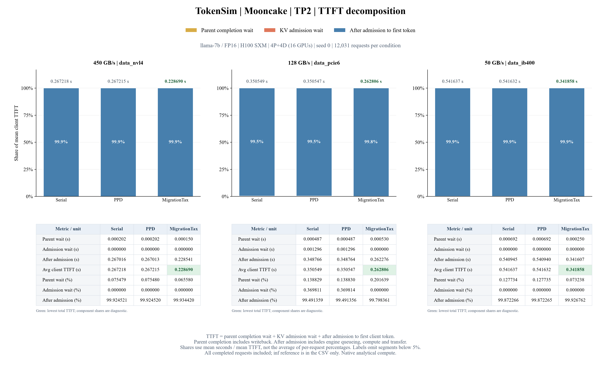

# TTFT 三部分時間組成



| 組成 | 定義 |
|---|---|
| 等待前輪完成 | 原始到達後，等指定前輪完整完成（含寫回）的時間；無前輪或前輪已完成則為 0。 |
| 等待 KV 准入 | 前輪條件滿足後，取得 P／D 保守 KV 預算前的等待；原始欄位為 `native_budget_wait_s`。 |
| 准入後至首 token | 完成准入、提交引擎後到 client 第一個 token；含引擎排隊、運算、傳輸，不是純 prefill 計算。 |

```text
parent_wait = max(0, parent.completed_at − arrival_s)，無 parent 時為 0
admission_wait = native_budget_wait_s
after_admission = client_TTFT − parent_wait − admission_wait
client_TTFT = parent_wait + admission_wait + after_admission
```

占比＝每段平均秒數／平均 client TTFT × 100%，也等於各段累計時間／累計 TTFT；不是先逐請求算百分比再平均。

分母包含全部 12,031 個完成請求，其中 3,959 筆 returning。初輪亦納入，前輪等待為 0。

准入後時間以既有 TTFT 減去兩段等待重建；另外核對原生路由時間戳等於到達＋前輪等待＋准入等待。沒有新增逐 step profiler，也沒有由這張圖拆分引擎內部的計算／傳輸／排隊。

這是平均值的組成，不能將三段各自的 P50／P95 相加視為 TTFT P50／P95。占比較高不代表絕對秒數較高；圖上方另標平均 TTFT 秒數。

## 秒數與占比

| TP | 連線 | 方法 | Avg TTFT s | 前輪等待 s | 准入等待 s | 准入後 s | 前輪 % | 准入 % | 准入後 % |
|---:|---|---|---:|---:|---:|---:|---:|---:|---:|
| 2 | inf | Serial | 0.236546 | 0.000346 | 0.000000 | 0.236200 | 0.146436 | 0.000000 | 99.853564 |
| 2 | nvl4 | Serial | 0.267218 | 0.000202 | 0.000000 | 0.267016 | 0.075479 | 0.000000 | 99.924521 |
| 2 | nvl4 | PPD | 0.267215 | 0.000202 | 0.000000 | 0.267013 | 0.075480 | 0.000000 | 99.924520 |
| 2 | nvl4 | MigrationTax | 0.228690 | 0.000150 | 0.000000 | 0.228541 | 0.065580 | 0.000000 | 99.934420 |
| 2 | pcie6 | Serial | 0.350549 | 0.000487 | 0.001296 | 0.348766 | 0.138829 | 0.369811 | 99.491359 |
| 2 | pcie6 | PPD | 0.350547 | 0.000487 | 0.001296 | 0.348764 | 0.138830 | 0.369814 | 99.491356 |
| 2 | pcie6 | MigrationTax | 0.262806 | 0.000530 | 0.000000 | 0.262276 | 0.201639 | 0.000000 | 99.798361 |
| 2 | ib400 | Serial | 0.541637 | 0.000692 | 0.000000 | 0.540945 | 0.127734 | 0.000000 | 99.872266 |
| 2 | ib400 | PPD | 0.541632 | 0.000692 | 0.000000 | 0.540940 | 0.127735 | 0.000000 | 99.872265 |
| 2 | ib400 | MigrationTax | 0.341858 | 0.000250 | 0.000000 | 0.341607 | 0.073238 | 0.000000 | 99.926762 |

TP1／2／4／8 的 GPU 總數為 8／16／32／64，KV 容量隨 TP 改變。TP1 重跑沒有加入跨 TP 彙整。
