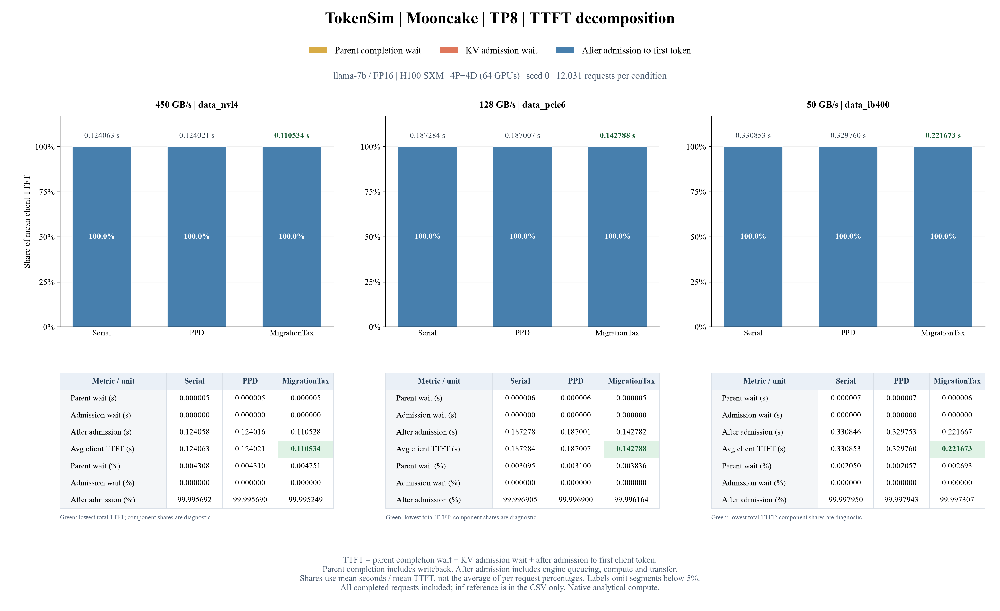

# TTFT 三部分時間組成



| 組成 | 定義 |
|---|---|
| 等待前輪完成 | 原始到達後，等指定前輪完整完成（含寫回）的時間；無前輪或前輪已完成則為 0。 |
| 等待 KV 准入 | 前輪條件滿足後，取得 P／D 保守 KV 預算前的等待；原始欄位為 `native_budget_wait_s`。 |
| 准入後至首 token | 完成准入、提交引擎後到 client 第一個 token；含引擎排隊、運算、傳輸，不是純 prefill 計算。 |

```text
parent_wait = max(0, parent.completed_at − arrival_s)，無 parent 時為 0
admission_wait = native_budget_wait_s
after_admission = client_TTFT − parent_wait − admission_wait
client_TTFT = parent_wait + admission_wait + after_admission
```

占比＝每段平均秒數／平均 client TTFT × 100%，也等於各段累計時間／累計 TTFT；不是先逐請求算百分比再平均。

柱內占比標籤保留小數點後一位：大於 99.5% 時採截位，其餘正常四捨五入。例如 99.996309% 顯示為 99.9%，75.176950% 顯示為 75.2%。柱高、CSV 與下方六位小數表保留原始計算值；低於 5% 的段落不在柱內標示。

TP1 另加一列 98%～100% 的局部放大圖，使用相同堆疊數值，讓約 0.4%～0.7% 的藍色區段可見。放大圖的藍色標籤仍表示它占完整 TTFT 的比例；主圖維持原本 0%～100% 的比例。

分母包含全部 12,031 個完成請求，其中 3,959 筆 returning。初輪亦納入，前輪等待為 0。

准入後時間以既有 TTFT 減去兩段等待重建；另外核對原生路由時間戳等於到達＋前輪等待＋准入等待。沒有新增逐 step profiler，也沒有由這張圖拆分引擎內部的計算／傳輸／排隊。

這是平均值的組成，不能將三段各自的 P50／P95 相加視為 TTFT P50／P95。占比較高不代表絕對秒數較高；圖上方另標平均 TTFT 秒數。

## 秒數與占比

| TP | 連線 | 方法 | Avg TTFT s | 前輪等待 s | 准入等待 s | 准入後 s | 前輪 % | 准入 % | 准入後 % |
|---:|---|---|---:|---:|---:|---:|---:|---:|---:|
| 8 | inf | Serial | 0.100285 | 0.000005 | 0.000000 | 0.100280 | 0.005150 | 0.000000 | 99.994850 |
| 8 | nvl4 | Serial | 0.124063 | 0.000005 | 0.000000 | 0.124058 | 0.004308 | 0.000000 | 99.995692 |
| 8 | nvl4 | PPD | 0.124021 | 0.000005 | 0.000000 | 0.124016 | 0.004310 | 0.000000 | 99.995690 |
| 8 | nvl4 | MigrationTax | 0.110534 | 0.000005 | 0.000000 | 0.110528 | 0.004751 | 0.000000 | 99.995249 |
| 8 | pcie6 | Serial | 0.187284 | 0.000006 | 0.000000 | 0.187278 | 0.003095 | 0.000000 | 99.996905 |
| 8 | pcie6 | PPD | 0.187007 | 0.000006 | 0.000000 | 0.187001 | 0.003100 | 0.000000 | 99.996900 |
| 8 | pcie6 | MigrationTax | 0.142788 | 0.000005 | 0.000000 | 0.142782 | 0.003836 | 0.000000 | 99.996164 |
| 8 | ib400 | Serial | 0.330853 | 0.000007 | 0.000000 | 0.330846 | 0.002050 | 0.000000 | 99.997950 |
| 8 | ib400 | PPD | 0.329760 | 0.000007 | 0.000000 | 0.329753 | 0.002057 | 0.000000 | 99.997943 |
| 8 | ib400 | MigrationTax | 0.221673 | 0.000006 | 0.000000 | 0.221667 | 0.002693 | 0.000000 | 99.997307 |

TP1／2／4／8 的 GPU 總數為 8／16／32／64，KV 容量隨 TP 改變。TP1 重跑沒有加入跨 TP 彙整。
