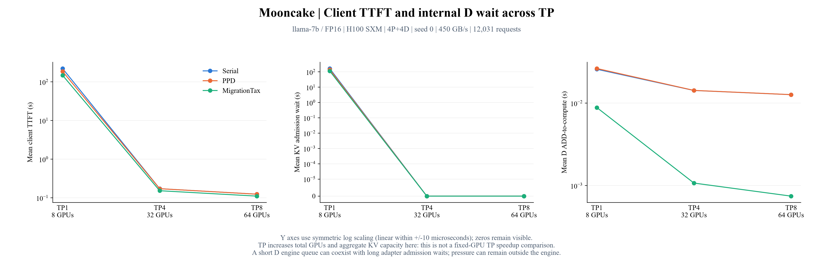

# Mooncake TP1／4／8：等待來源與 P／D 時間

本次修正 MigrationTax 預算取得時間戳後的三批均已完成，共 30／30 條件。



## 建議給學姊的閱讀順序

以 TP1 的 `figure.png` 區分前輪、准入與准入後時間；`worker-steps.png` 檢查每步載入、運算與 batch；`matched-request-timeline.png` 對照同一 source ID 的 P／D 起訖。
TP4／8 用來觀察增加 GPU 與 KV 容量後的情況，不能視為固定總卡數下的 TP 對照。

| TP | 模擬 GPU 數 | 完成條件 | 報告 | 主圖 | 完整逐請求時間戳 |
|---:|---:|---:|---|---|---|
| 1 | 8 | 10／10 | [欄位、表格與圖](../mooncake7b-h100-tp1-pd-timeline-s0-02/PD_TIMELINE.md) | [figure.png](../mooncake7b-h100-tp1-pd-timeline-s0-02/figure.png) | [ZIP](../mooncake7b-h100-tp1-pd-timeline-s0-02/request-timelines.zip) |
| 4 | 32 | 10／10 | [欄位、表格與圖](../mooncake7b-h100-tp4-pd-timeline-s0-02/PD_TIMELINE.md) | [figure.png](../mooncake7b-h100-tp4-pd-timeline-s0-02/figure.png) | [ZIP](../mooncake7b-h100-tp4-pd-timeline-s0-02/request-timelines.zip) |
| 8 | 64 | 10／10 | [欄位、表格與圖](../mooncake7b-h100-tp8-pd-timeline-s0-02/PD_TIMELINE.md) | [figure.png](../mooncake7b-h100-tp8-pd-timeline-s0-02/figure.png) | [ZIP](../mooncake7b-h100-tp8-pd-timeline-s0-02/request-timelines.zip) |

## 450 GB/s 的觀察

- Serial：平均 TTFT 221.693914 秒；前輪等待 53.984778 秒、准入 166.662724 秒、准入後 1.046412 秒。准入又分成等 P 164.842286 秒與等 D 1.820438 秒。
- PPD：平均 TTFT 186.824738 秒；前輪等待 42.240481 秒、准入 143.570155 秒、准入後 1.014103 秒。准入又分成等 P 141.782228 秒與等 D 1.787927 秒。
- MigrationTax：平均 TTFT 147.961256 秒；前輪等待 31.722968 秒、准入 115.304965 秒、准入後 0.933323 秒。准入又分成等 P 108.156161 秒與等 D 7.148804 秒。

這批 TP1 的大量等待發生在原生引擎提交之前，支持先檢查 parent 依賴與 KV 准入。
D ADD→compute／output 只衡量已受理請求；不能直接排除 decode 吞吐或 KV 容量對上游等待的影響。
要區分負載過重與其他策略影響，仍需另做控制 arrival rate 的對照；本批沒有更動 arrival rate。

## TP1 數值

| 連線 | 方法 | Avg TTFT s | P50 s | P95 s | 前輪 s | 等 P 預算 s | 等 D 預算 s | 准入後 s | D ADD→compute s | D ADD→output s |
|---|---|---:|---:|---:|---:|---:|---:|---:|---:|---:|
| inf | Serial | 163.738328 | 123.441644 | 477.389841 | 33.154743 | 128.018317 | 1.631617 | 0.933651 | 0.007927 | 0.027399 |
| nvl4 | Serial | 221.693914 | 139.158897 | 723.026677 | 53.984778 | 164.842286 | 1.820438 | 1.046412 | 0.025735 | 0.044305 |
| nvl4 | PPD | 186.824738 | 101.989710 | 584.991417 | 42.240481 | 141.782228 | 1.787927 | 1.014103 | 0.026284 | 0.045670 |
| nvl4 | MigrationTax | **147.961256** | **75.384594** | **542.976095** | 31.722968 | 108.156161 | 7.148804 | 0.933323 | 0.008834 | 0.030131 |
| pcie6 | Serial | 248.368308 | 114.926990 | 848.723254 | 64.853628 | 180.776332 | 1.582328 | 1.156020 | 0.074175 | 0.093124 |
| pcie6 | PPD | 257.098716 | 106.567934 | 912.526622 | 68.261624 | 186.260215 | 1.387585 | 1.189293 | 0.072870 | 0.091600 |
| pcie6 | MigrationTax | **161.200284** | **83.920213** | **544.731663** | 33.965563 | 119.091882 | 7.066191 | 1.076648 | 0.008812 | 0.030176 |
| ib400 | Serial | 345.318255 | 206.796780 | 1125.434246 | 96.968787 | 245.033124 | 1.774436 | 1.541908 | 0.190890 | 0.210286 |
| ib400 | PPD | 370.660338 | **101.727730** | 1402.564754 | 114.783233 | 252.681564 | 1.640587 | 1.554954 | 0.186004 | 0.204998 |
| ib400 | MigrationTax | **200.430121** | 115.831315 | **644.100808** | 47.302303 | 144.589350 | 7.177458 | 1.361010 | 0.008589 | 0.029388 |

## 欄位與計算公式

所有原始時間戳、CSV 的時間差都是模擬秒；圖中的引擎細節另換算為 ms（乘 1,000）。
空白表示未觀測或不適用，不能直接補成 0。

| 組成／指標 | 原始 CSV 欄位與公式 | 統計分母／注意事項 |
|---|---|---|
| Client TTFT | `first_client_output_at_s - arrival_s`，等於 `ttft_s` 與原生匯出 `native_prefill_latency_s` | 全部 12,031 個完成請求；包含初輪與 returning |
| 前輪等待 | `parent_ready_s - arrival_s` | 全部請求；無前輪或已完成為 0；前輪完成包含寫回 |
| KV 准入等待 | `submitted_s - admission_started_s`，等於 `admission_wait_s`／`native_budget_wait_s` | 全部請求；`admission_started_s = parent_ready_s` |
| 等 P 預算 | `p_budget_acquired_s - admission_started_s` | 全部請求平均；D-only 分支不需要 P，對這段總量貢獻為 0，另外保留 P 觀測數 |
| 等 D 預算 | 有 P 時為 `d_budget_acquired_s - p_budget_acquired_s`；D-only 時為 `d_budget_acquired_s - admission_started_s` | 全部請求；成功取得預算的時間，未保留已放棄的暫時 D reservation |
| 准入後到首 token | `first_client_output_at_s - submitted_s` | 全部請求；包括原生排隊、運算與傳輸 |
| P 進入訊息佇列 | `p_queue_enter_s` | ADD 訊息送進 worker 的時間，當時 worker 可能仍在執行別批 |
| P 開始／結束 | `p_prefill_start_s`／`p_prefill_end_s` | Prompt 的第一個 compute 開始／最後一個 prompt step 完成；後者包含 FF 層間 handoff barrier |
| P prompt window | `p_prefill_end_s - p_prefill_start_s` | 有 P prompt 起訖的請求；這個跨度包含中間空隙，不是純 kernel 累計 |
| P 最後 prompt kernel 結束 | `p_last_prefill_compute_end_s` | 排除最後 handoff 等待；HF 的 P-side decode 另看 `p_last_compute_end_s` |
| D 進入訊息佇列 | `d_queue_enter_s` | ADD 訊息進入 worker；不是進入實際 scheduler 的時間 |
| D 訊息等待 | `d_scheduler_enter_s - d_queue_enter_s` | 有對應時間戳的請求 |
| D scheduler 到 compute | `d_first_compute_start_s - d_scheduler_enter_s` | 包含原生 scheduler／blocking load 等等待，不等於純排程成本 |
| D ADD 到 compute | `d_first_compute_start_s - d_queue_enter_s` | 上兩段相加；可能以 D-local prefill 開始 |
| D ADD 到首輸出 | `first_d_output_at_s - d_queue_enter_s` | 包含第一次 D 輸出前的排程、載入、運算；D-local prefill 也能產生首 token |
| 第一步 decode 結束 | `d_first_decode_step_end_s` | 第一次在排程時被分類為 decode 的 D compute step 結束；可能晚於第一個 D 輸出 |
| 第一步 D decode batch | `d_first_decode_batch_size` | 每個有觀測到 D decode 的請求各取第一次；分母與所有 D steps 不同 |
| 每步 blocking load | `worker-steps.csv: load_wait_s` | 每個 scheduling step 一筆；FF 的顯式層級 Store 讀取另見 `kv-transfers.csv` |
| 每步 batch 大小 | `batch_size`（請求數）、`batch_tokens`（當次 query tokens） | TP 群組 leader 的每一步，不是每張 GPU 各算一次 |
| 每步運算累計 | `compute_service_s` | 真正 compute 呼叫時間累計，包含原生 TP 成本；不能再把 TP 通訊加一次 |
| 每步其他等待 | `precompute_wait_s`、`between_compute_wait_s`、`postcompute_wait_s` | 根據時間戳的剩餘跨度；沒有直接標註來源的部分不能全歸因於某條 link |
| 顯式 KV 傳輸 | `kv-transfers.csv` 的 `queued_at_s`／`service_started_s`／`service_ended_s`、`queue_wait_s`／`service_s` | 僅 MigrationTax 的 FF／HF 顯式事件；Serial／PPD 表只有 header，不代表沒傳輸 |

```text
TTFT = 前輪等待 + KV 准入等待 + 准入後到首 token
KV 准入等待 = 等 P 預算 + 等 D 預算
step span = load_wait + precompute_wait + compute_service
            + between_compute_wait + postcompute_wait
```

P→D 准入順序會把部分等待先記在 P；不能從「D 預算等待較短」推論 D 沒壓力。
P／D 的執行窗、傳輸窗與共享 batch 可能重疊，不能全部相加當成 TTFT。
每步 span 在 Store 最終同步寫回等待之前結束；完整生命週期則包含寫回。
TTFT 占比採各段平均秒數／平均 TTFT，並非逐請求百分比的平均。
三段各自的 P50／P95 也不能相加成為總 TTFT 的 P50／P95。
占比標籤保留小數一位；大於 99.5% 採截位，其餘正常四捨五入，圖高與 CSV 不截值。

## 實驗條件與解讀限制

三批都是 llama-7b／FP16、H100 SXM、4P＋4D、seed 0、Mooncake shifted v1 全集。
每條件 12,031 個請求、3,959 筆 returning、4,122,048 個輸出 tokens。
三種 KV 通訊頻寬為 450／128／50 GB/s，另有同 TP 的 Serial inf reference。
HBM 固定 3,352 GB/s，TP 群組內 collective 的網路設定維持固定。
計時使用原生 operator analytical 模型；這些數字不是 vLLM 或真實 GPU 實測。

TP1／4／8 分別使用 8／32／64 張模擬 GPU，KV 容量也隨 TP 增加。
這組比較同時改變算力與記憶體資源，不能解釋為固定 GPU 總數下的 TP 加速比。
Serial inf 仍有 Serial 路由、准入、batching 與 TP 通訊，只把指定 KV link 設為極高頻寬。
它不是所有方法共用的理論下界，也不等於移除全部 migration 機制。
目前每條件只有 seed 0；不提供跨 seed 信賴區間或一般化的硬體性能結論。

## 紀錄與驗證

製圖從已完成的輸出重建，沒有重新模擬，也沒有調整 arrival、KV 配額或方法策略。
原生觀測功能的 658 項單元測試已通過；修正 MigrationTax 預算時間戳後，TP1／4／8 × 兩個 traces 的 128 筆 on/off CLI 對照亦通過。
對照確認開關觀測的 request records 相同，原生結果僅允許實際執行耗時欄位不同。
本次完整 30 條件亦與各自未加觀測的歷史對照逐位元組比對 `requests.jsonl`，共 30／30 相同；校驗值見 `pd-integrity.json`。
這可支持觀測功能沒有改變已測案例行為，仍不等於硬體延遲模型已校準。

本報告另逐條件核對通過的稽核收據、12,031 個原生 request IDs、TTFT、到達與完成時間、P／D 預算時間戳、逐 step 的時間加總與顯式傳輸起訖。
完整掃描每一步，但只在記憶體保留累計統計、batch 計數與指定請求的小樣本。
`pd-verification.json` 保存來源 request／route／稽核／timeline 的 SHA-256 與圖檔校驗值。
稽核和公式一致只能證明這批紀錄的內部一致性；負載、准入策略與 analytical 計時仍需獨立驗證。
